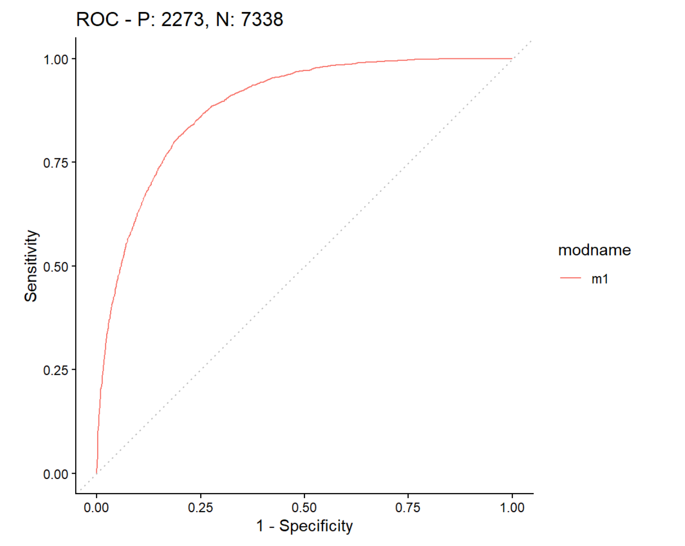
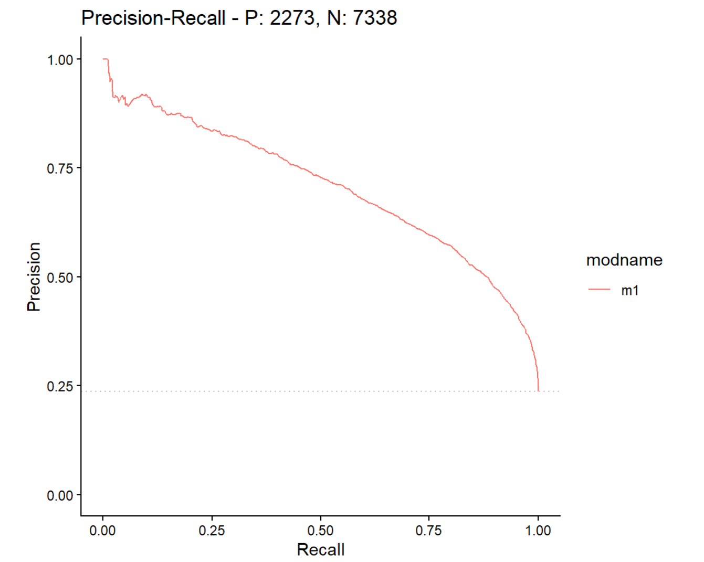

# m6APrediction

## Overview

`m6APrediction` is an R package for predicting N6-methyladenosine (m6A) status using a supplied trained model and sequence and genomic features.

The package provides two prediction functions:

-   `prediction_multiple()`: predicts m6A probabilities and classifications for multiple input rows.
-   `prediction_single()`: predicts m6A probability and classification for a single input.

The helper function `dna_encoding()` converts DNA sequences into position-specific categorical features. The package uses an existing model; the examples below do not retrain it.

## Installation

Install the package from GitHub:

``` r
install.packages("remotes")
remotes::install_github("SihanChen-xjtlu/m6APrediction")
```

Load the package:

``` r
library(m6APrediction)
```

## Input features

The input data frame for `prediction_multiple()` must contain these columns:

| Column | Expected input |
|------------------------------------|------------------------------------|
| `gc_content` | Numeric GC content, using the same scale as the training data |
| `RNA_type` | One of `mRNA`, `lincRNA`, `lncRNA`, or `pseudogene` |
| `RNA_region` | One of `CDS`, `intron`, `3'UTR`, or `5'UTR` |
| `exon_length` | Numeric exon length |
| `distance_to_junction` | Numeric distance to a junction |
| `evolutionary_conservation` | Numeric conservation score |
| `DNA_5mer` | A five-base DNA sequence containing uppercase `A`, `T`, `C`, and `G` |

Use the same feature definitions, units, and preprocessing as those used to train the model. The functions do not provide comprehensive validation of input values.

The model must support probability predictions through `predict(..., type = "prob")`, with a probability column named `Positive`.

## Minimal example

### Load the supplied model and example data

``` r
library(m6APrediction)

model_path <- system.file(
  "extdata", "rf_fit.rds",
  package = "m6APrediction",
  mustWork = TRUE
)

data_path <- system.file(
  "extdata", "m6A_input_example.csv",
  package = "m6APrediction",
  mustWork = TRUE
)

ml_fit <- readRDS(model_path)

example_data <- read.csv(
  data_path,
  stringsAsFactors = FALSE
)
```

### Predict multiple inputs

``` r
multiple_results <- prediction_multiple(
  ml_fit = ml_fit,
  feature_df = example_data,
  positive_threshold = 0.5
)

head(multiple_results)
```

The function returns the input features with two additional columns:

-   `predicted_m6A_prob`: predicted probability of the `Positive` class.
-   `predicted_m6A_status`: predicted classification, either `Positive` or `Negative`.

A probability strictly greater than `positive_threshold` is classified as `Positive`. All other non-missing probabilities are classified as `Negative`.

### Predict a single input

Use the first row of the supplied example data:

``` r
one_input <- example_data[1, , drop = FALSE]

single_result <- prediction_single(
  ml_fit = ml_fit,
  gc_content = one_input$gc_content,
  RNA_type = one_input$RNA_type,
  RNA_region = one_input$RNA_region,
  exon_length = one_input$exon_length,
  distance_to_junction = one_input$distance_to_junction,
  evolutionary_conservation = one_input$evolutionary_conservation,
  DNA_5mer = one_input$DNA_5mer,
  positive_threshold = 0.5
)

single_result
```

The function returns a named character vector containing `predicted_m6A_prob` and `predicted_m6A_status`. Convert the probability to numeric when needed:

``` r
single_probability <- as.numeric(
  single_result["predicted_m6A_prob"]
)
```

## Model performance

The random forest model was evaluated on a held-out test set. The ROC curve shows how well the model distinguishes m6A-positive sites from negative sites across classification thresholds. The area under the ROC curve (AUROC) was **0.8871**.



The precision–recall curve shows the trade-off between identifying more m6A-positive sites (recall) and the proportion of predicted positives that are correct (precision). The area under this curve (AUPRC) was **0.7074**, above the baseline of **0.2365** given by the proportion of positive sites in the test set.


